# Secure Task Manager — Flutter + Node.js

Implementación completa del tutorial *Full-Stack Tutorial: Secure Task Manager with Flutter and Node.js*
(todas las secciones 1–20, el ejercicio práctico 19a) **y los 8 retos de extensión**.

```
secure_task_manager/
  backend/   API REST versionada: Express 5, PostgreSQL 16, Prisma 6, Zod, JWT, bcrypt
  mobile/    Cliente Flutter: Riverpod, http, flutter_secure_storage
  .github/   CI/CD (tests, migraciones, auditoría de dependencias, escaneo de secretos) + Dependabot
```

## Prueba rápida (5 minutos)

Requisitos: Docker Desktop abierto, Node.js y Flutter. Desde `secure_task_manager/`:

```bash
cd backend
docker compose up -d
npx prisma migrate deploy
npm run seed:demo
npm run dev
```

En otra terminal:

```bash
cd mobile
flutter run -d chrome --web-port 8080 --dart-define=API_BASE_URL=http://localhost:3000/api/v1
```

Entra con la cuenta demo **`demo@example.test` / `demo-password-1234`** (administradora, 6 tareas) o con
**`alex@example.test` / `alex-password-1234`** (usuario normal). Son valores de prueba solo para tu base de datos local.

## Capturas de pantalla

Todas las capturas son de la app Flutter (web) funcionando contra la API real y PostgreSQL, tomadas el 2026-10-23.

### Inicio de sesión y registro

| Login | Contraseña incorrecta (mensaje genérico) |
|---|---|
| 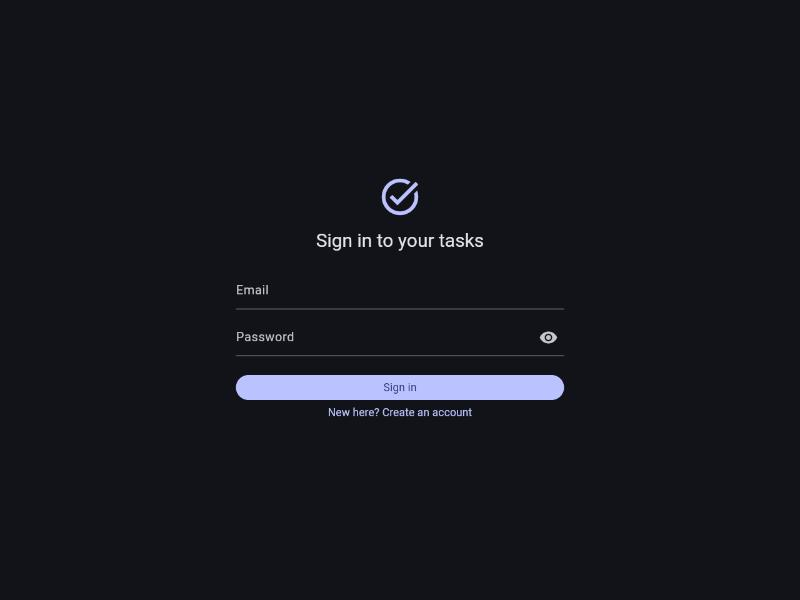 | 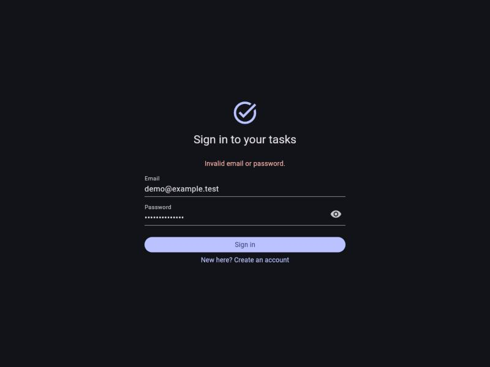 |

| Validación del registro | Sesión revocada en el servidor → vuelve al login |
|---|---|
| 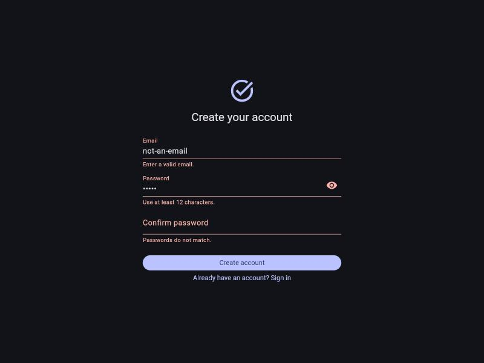 | 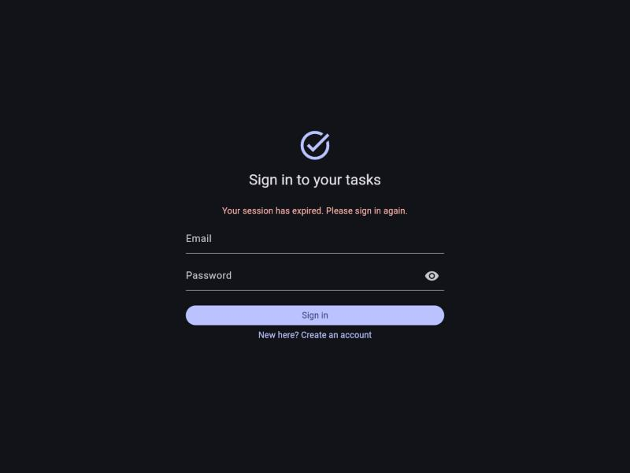 |

### Tareas: crear, buscar, filtrar, editar y borrar

| Lista de tareas | Nueva tarea (formulario validado) |
|---|---|
| 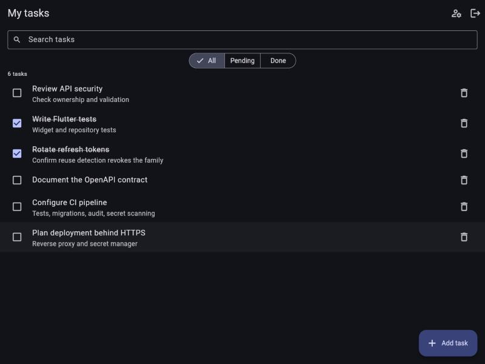 | 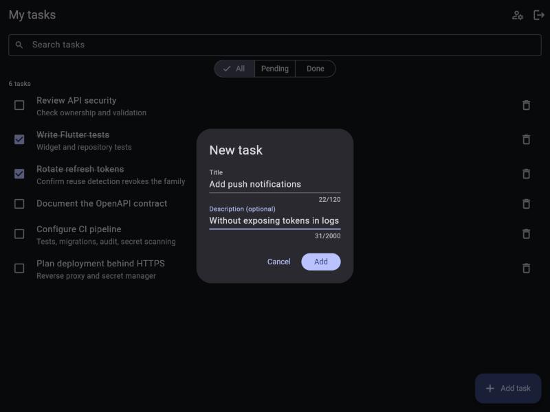 |

| Tarea añadida | Búsqueda en título y descripción |
|---|---|
| 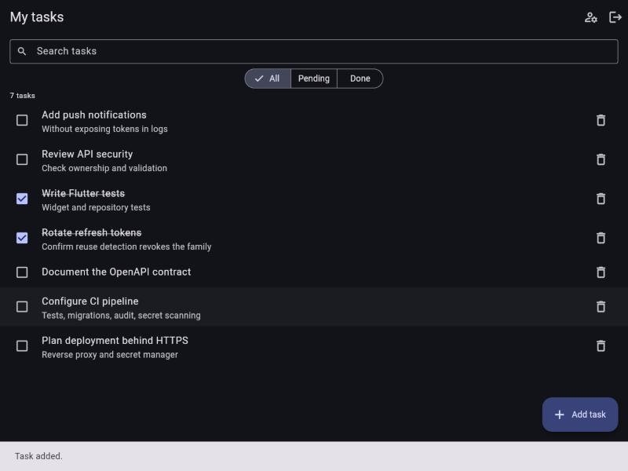 | 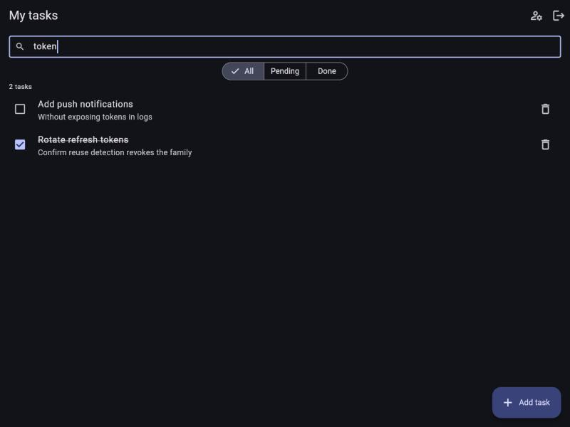 |

| Búsqueda + filtro "Done" | Editar tarea (reto de extensión) |
|---|---|
| 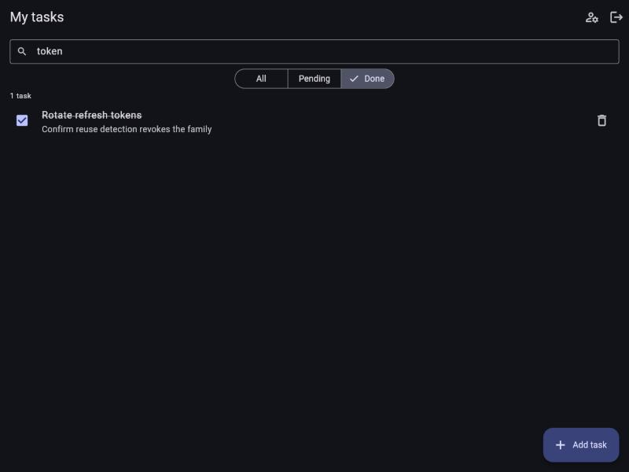 | 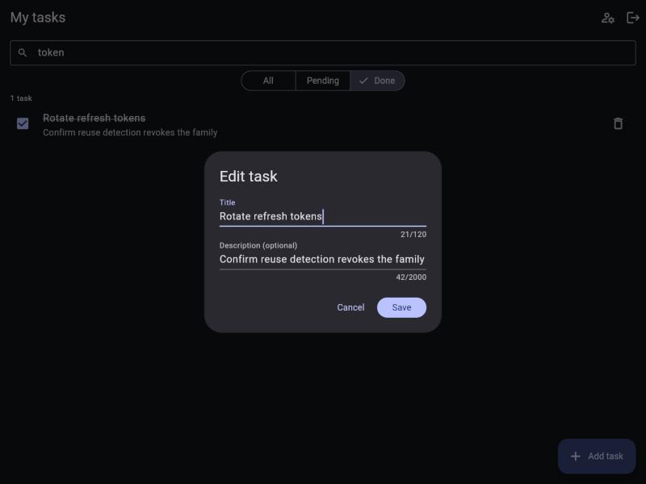 |

| Confirmación antes de borrar | Tarea borrada |
|---|---|
| 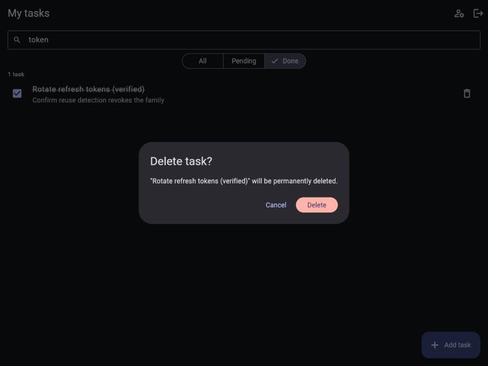 | 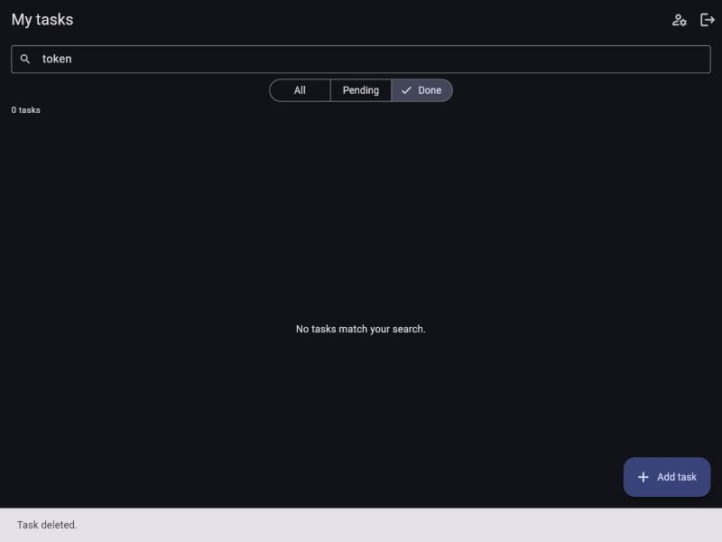 |

### Cuenta, sesiones y administración

| Cuenta: sesiones por dispositivo y actividad de seguridad | Cerrar la sesión de otro dispositivo |
|---|---|
| 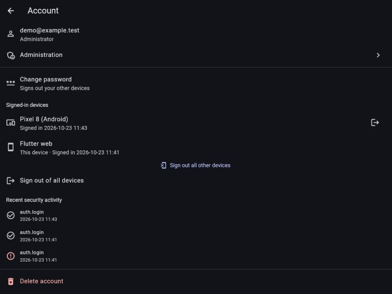 | 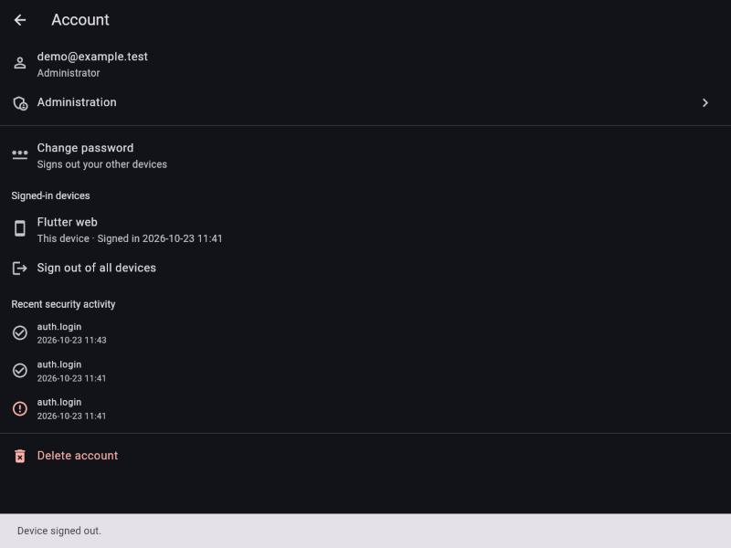 |

| Administración: usuarios y roles | Cambiar el rol de otro usuario |
|---|---|
| 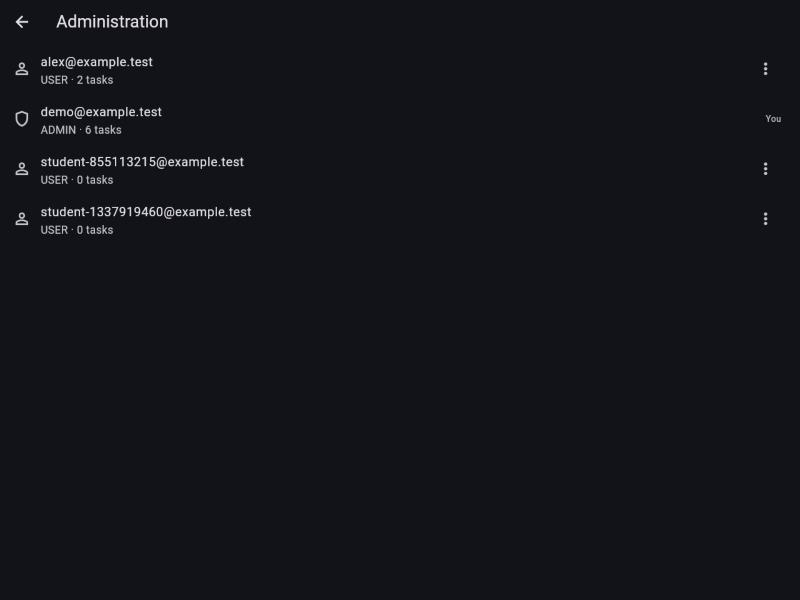 | 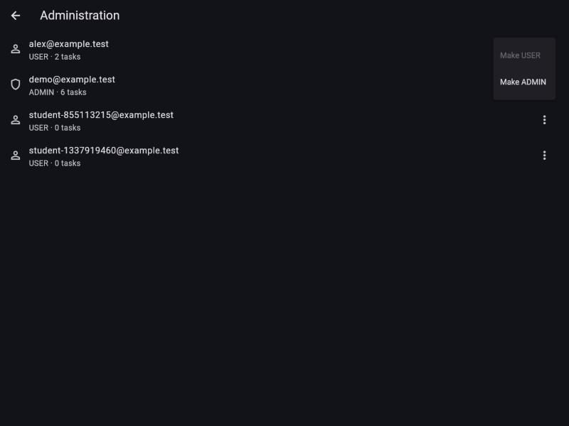 |

### Tests y ejercicio 19a

| Backend: 80/80 tests | Flutter: 29/29 tests + analyze sin avisos |
|---|---|
| 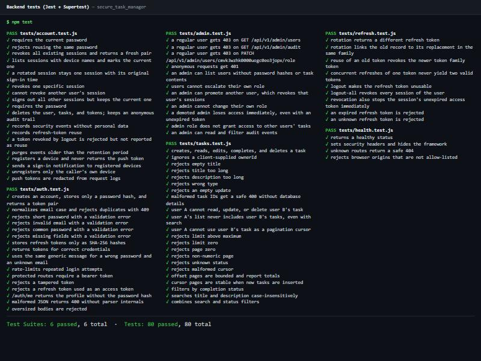 | 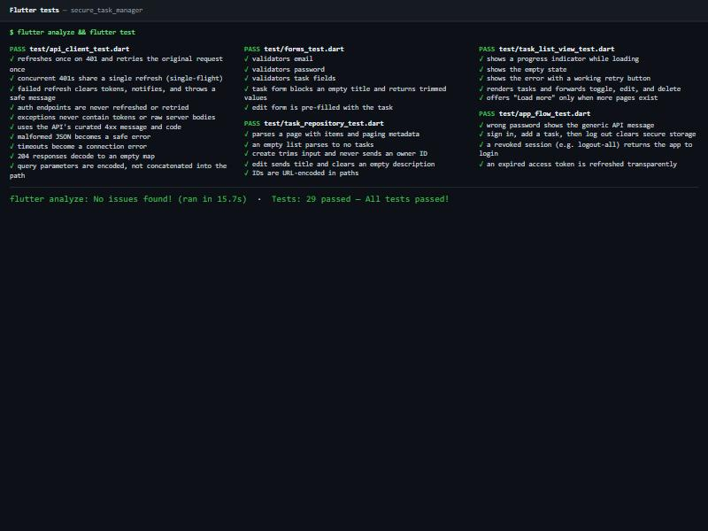 |

**Ejercicio 19a: 5/5 comprobaciones superadas**

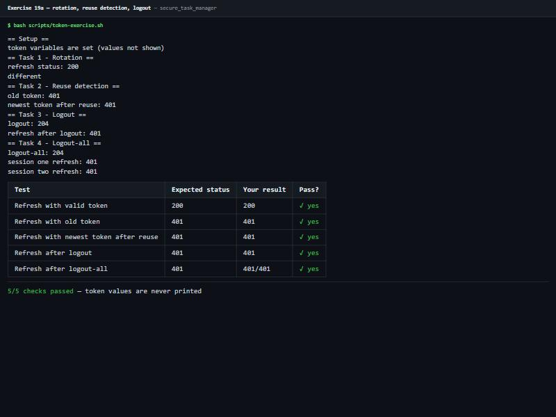

## Puesta en marcha

### Backend

```bash
cd backend
cp .env.example .env            # y pon secretos aleatorios largos en JWT_*
docker compose up -d            # PostgreSQL 16
npx prisma migrate dev
npm run dev                     # http://localhost:3000/health
```

> En esta máquina ya hay un PostgreSQL nativo en el puerto 5432, por eso `compose.yaml` admite
> `POSTGRES_HOST_PORT` y el `.env` local usa **5433**. Si 5432 está libre, no hace falta cambiar nada.

Generar secretos:

```bash
node -e "console.log(require('crypto').randomBytes(48).toString('base64url'))"
```

### Tests del backend (base de datos aislada)

```bash
cp .env.test.example .env.test  # base de datos local terminada en _test
npm run test:db                 # aplica migraciones (se niega si no es local *_test)
npm test
```

### Ejercicio 19a (rotación, reutilización, logout, logout-all)

```bash
npm run dev                     # en otra terminal
bash scripts/token-exercise.sh  # usa jq si existe; si no, Node para leer JSON
```

### Flutter

```bash
cd mobile
flutter pub get
flutter test
flutter run --dart-define=API_BASE_URL=http://10.0.2.2:3000/api/v1   # emulador Android
flutter run -d chrome --dart-define=API_BASE_URL=http://localhost:3000/api/v1   # web (añade el origen a CORS_ORIGINS)
```

### Administrador (roles)

No existe ninguna ruta de API para convertirse en el primer admin; se hace con acceso al servidor:

```bash
npm run user:promote -- persona@example.test
```

## Qué incluye

| Sección del documento | Dónde |
|---|---|
| 2. Docker Compose | `backend/compose.yaml` |
| 4. Secretos locales | `.gitignore`, `.env.example`, `src/config.js` (validación con Zod) |
| 5. Esquema | `prisma/schema.prisma` + `prisma/migrations/` |
| 6. Validación | `src/schemas/*`, `src/middleware/validate.middleware.js` |
| 7. Contraseñas y tokens | `src/utils/tokens.js`, `src/services/auth.service.js` |
| 8–9. App segura y errores | `src/app.js`, `src/middleware/error.middleware.js` |
| 10. Repositorios y propiedad (IDOR) | `src/repositories/*` (filtran siempre por `ownerId`) |
| 11. Auth, rotación, reuse detection, logout | `src/routes/auth.routes.js`, `src/controllers/*`, `src/services/auth.service.js` |
| 12. Contrato OpenAPI | `backend/openapi.yaml` (completo, validado con Redocly) |
| 13. Servidor y apagado ordenado | `src/server.js` |
| 14–18. Cliente Flutter | `mobile/lib/core/*`, `mobile/lib/features/*` |
| 19 / 19a. Verificación y ejercicio | `backend/scripts/token-exercise.sh` |
| 20. Tests | `backend/tests/*` (80 tests), `mobile/test/*` (29 tests) |

### Retos de extensión

| Reto | Implementación |
|---|---|
| Borrado de cuenta, cambio de contraseña con revocación de sesiones, gestión de dispositivos/sesiones | `DELETE /auth/account` (pide contraseña), `POST /auth/change-password` (revoca todas las sesiones y devuelve un par nuevo), `GET/DELETE /auth/sessions[/:id]`. Pantalla **Account** en Flutter. |
| Edición completa de tareas con formulario validado | `TaskFormDialog` (crear y editar, mismas reglas que la API) + `GET /tasks/:id` |
| Roles y autorización por rol | Enum `Role` (USER/ADMIN), `requireRole('ADMIN')` lee el rol **de la BD** en cada petición (una degradación es inmediata), rutas `/api/v1/admin/*`, pantalla de administración. Ser admin **no** da acceso a tareas ajenas. |
| Búsqueda, filtros y paginación estable | `q` (título/descripción, sin distinguir mayúsculas), `status=all|pending|completed`, orden determinista `createdAt desc, id desc`, paginación por cursor (`nextCursor`) además de por página. Buscador, filtros y «Load more» en Flutter. |
| Notificaciones push sin exponer tokens en logs | Modelo `DeviceToken`, `POST /auth/devices`, `GET /auth/devices` (nunca devuelve el token), `POST /auth/devices/unregister`; avisos de «nuevo inicio de sesión», «contraseña cambiada» y «reutilización detectada». Los tokens se redactan en logs (`pushToken` en `REDACT_PATHS`). Proveedor `log` en desarrollo; en Flutter, `PushTokenSource` listo para conectar `firebase_messaging`. |
| CI/CD | `.github/workflows/ci.yml`: gitleaks, `npm audit`, `prisma migrate deploy`, comprobación de deriva migraciones↔schema, lint OpenAPI, Jest, `dart format`, `flutter analyze`, `flutter test`. `.github/dependabot.yml`. |
| Auditoría con minimización de datos | Modelo `AuditEvent` solo con `userId`, `action`, `outcome`, `createdAt` (sin email, IP, user-agent, tokens ni cuerpos). Al borrar la cuenta el evento queda anónimo (`SetNull`). `GET /auth/audit` (propios), `GET /admin/audit`, retención con `npm run audit:purge` (`AUDIT_RETENTION_DAYS`). |
| Tests de integración de acceso cruzado | `tests/tasks.test.js` → «cross-user authorization (IDOR)»: A no puede leer/editar/borrar/listar/usar como cursor las tareas de B; también sesiones y dispositivos ajenos. |

## Correcciones respecto al documento

El código del documento se siguió tal cual salvo en estos puntos, donde fallaba o era inseguro:

1. **Tarea 1 del ejercicio 19a**: `ROTATION_STATUS` hacía un *segundo* `refresh` con el token ya rotado. Eso dispara la
   detección de reutilización y revoca la familia, así que la Tarea 1 «pasaba» por accidente y la Tarea 2 no probaba nada.
   El script toma el status de la **misma** petición.
2. **Express 5** (el que instala `npm install express` hoy) expone `req.query` como getter: `req[key] = parsed.data`
   lanzaba error. El middleware de validación usa `Object.defineProperty`.
3. **Cliente Flutter**: `base.replace(path: 'tasks?page=1')` codificaba el `?` como `%3F` y la petición iba a otra ruta.
   `ApiClient.send` acepta ahora `query:` y codifica los parámetros.
4. **CORS** rechazado devolvía 500; ahora es 403 `CORS_REJECTED`. JSON mal formado y cuerpos > 20 kB dan 400/413 sin detalles internos.
5. **Rotación concurrente**: dos `refresh` simultáneos con el mismo token podían generar dos tokens válidos. Ahora el
   `updateMany ... revokedAt: null` debe afectar exactamente a 1 fila; si no, se trata como reutilización.
6. **Revocación inmediata**: el access token incluye `sid` (la familia) y `requireAuth` comprueba que la sesión sigue activa.
   Así, logout / logout-all / cambio de contraseña / borrado de cuenta cortan el acceso **en la siguiente petición**,
   que es lo que pide la comprobación «Flutter app check» (antes había que esperar hasta 10 min).
7. Solo se registra `refresh_reuse_detected` cuando se presenta un token **rotado** (`replacedById`), no uno cerrado por logout.
8. Se validan los IDs de ruta (`taskId`, `sessionId`, `userId`), como pide la sección 11.
9. En el login, el aviso «sesión expirada» ya no aparece también en el formulario de registro (encontrado al hacer las capturas).
10. Prisma se fija en la v6 (el `schema.prisma` del documento usa `prisma-client-js` + `url`, que la v7 cambia) y se fuerza
   `deepmerge-ts@^8.0.2` vía `overrides` para eliminar 3 vulnerabilidades altas: `npm audit` → 0.

## Resultados del ejercicio 19a (ejecución real)

| Test | Expected status | Your result | Pass? |
|---|---|---|---|
| Refresh with valid token | 200 | 200 | ✅ |
| Refresh with old token | 401 | 401 | ✅ |
| Refresh with newest token after reuse | 401 | 401 | ✅ |
| Refresh after logout | 401 | 401 | ✅ |
| Refresh after logout-all | 401 | 401 / 401 | ✅ |

Inspección de la BD (sin `tokenHash`): cada refresh crea una fila nueva, la anterior queda con `revokedAt` y
`replacedById`, todas comparten `familyId` y, tras la reutilización, toda la familia queda revocada.

**Flutter app check** (probado en Flutter web contra la API real): registro, crear, editar, completar, filtrar,
pantalla de cuenta con sesiones y actividad; tras un `logout-all` por curl, la siguiente petición de la app vuelve al
login con «Your session has expired» y el almacenamiento seguro queda vacío.

## Reflect and discuss

**¿Por qué rotar los refresh tokens?** Cada token sirve una sola vez. Si alguien roba uno, su valor dura hasta el
próximo uso legítimo, y el robo se *detecta*, porque uno de los dos presentará un token ya usado.

**¿Qué pasaría si el servidor guardara los refresh tokens en claro?** Una fuga de la base de datos (backup, inyección,
acceso interno) daría sesiones válidas de todos los usuarios al instante. Con SHA-256 solo se guarda un resumen que
no sirve para autenticarse. Al ser 48 bytes aleatorios, no hace falta sal ni un hash lento.

**¿Por qué la reutilización revoca toda la familia?** El servidor no puede saber quién es el legítimo, si el cliente o
el atacante. Revocar toda la familia corta a ambos y obliga a volver a autenticarse con la contraseña, que el atacante
no tiene.

**¿Qué compromiso hay si un cliente legítimo reintenta un refresh tras un timeout?** Si el servidor rotó el token pero
la respuesta se perdió, el reintento presenta el token antiguo. Eso se ve como reutilización y cierra la sesión del
usuario. Es la razón de que el cliente nunca reintente `auth/refresh` y use *single-flight*. Una alternativa es un
periodo de gracia corto para el token recién rotado, a cambio de algo de seguridad.

## Tests

- Backend: **80 tests** (Jest + Supertest) — registro, credenciales, validación, tokens manipulados, rotación,
  reutilización, concurrencia, logout/logout-all, expiración, IDOR, paginación/búsqueda/filtros, errores seguros,
  rate limit, CORS, cuenta, sesiones, roles, auditoría y push.
- Flutter: **29 tests** — refresh + un único reintento, single-flight, refresh fallido, excepciones sin tokens ni
  cuerpos crudos, timeouts, JSON inválido, codificación de query, repositorio (mocktail), estados de la lista,
  validadores y formularios, y flujos completos de la app con una API falsa.
